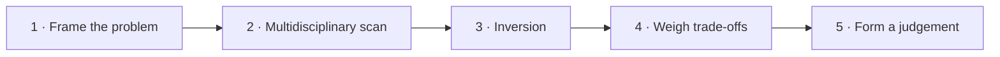
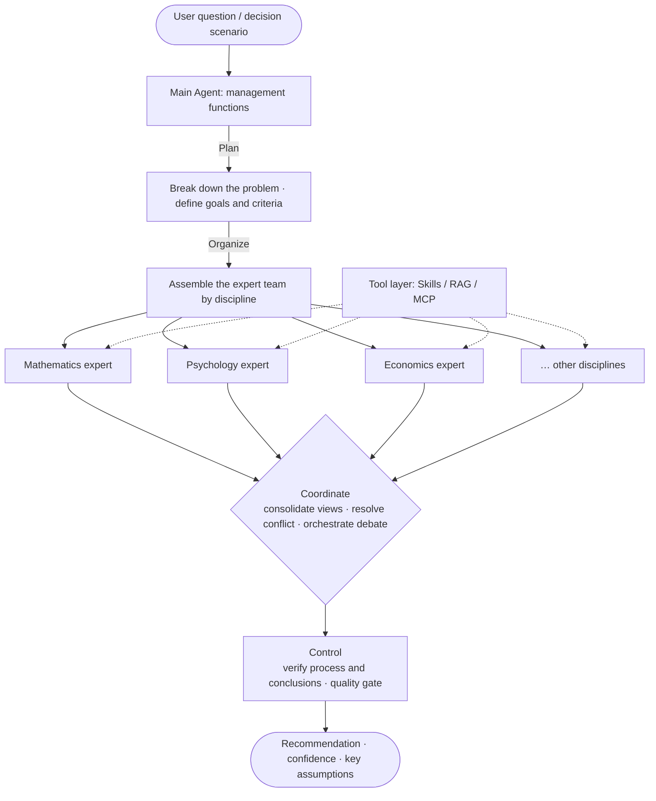

<div align="center">

[**English**](README.md) · [简体中文](README.zh-CN.md)

# MungerMind

**Think like Munger — break the innovation boundary of AI agents with multidisciplinary mental models**

*A cross-disciplinary mental-model engine for multi-agent decision support.*

[](https://www.python.org/)
[](https://docs.astral.sh/uv/)
[](https://platform.openai.com/docs)
[](https://github.com/crewAIInc/crewAI)
[](https://modelcontextprotocol.io/)
[](#-roadmap)
[](#-contributing)

[Quick Start](#-quick-start) · [Core Ideas](#-core-ideas) · [Architecture](#-architecture) · [Roadmap](#-roadmap) · [FAQ](#-faq)

</div>

---

## 📑 Table of Contents

- [✨ Features](#-features)
- [📖 Overview](#-overview)
- [🧠 Core Ideas](#-core-ideas)
  - [Multidisciplinary Mental Models](#multidisciplinary-mental-models)
  - [Forced Thinking Order](#forced-thinking-order)
  - [Multi-Agent Expert Team](#multi-agent-expert-team)
  - [Management Functions](#management-functions)
  - [Social Psychology Governance](#social-psychology-governance)
  - [Tool Layer](#tool-layer)
  - [Liquid Glass UI](#liquid-glass-ui)
- [🧩 Architecture](#-architecture)
- [🚀 Quick Start](#-quick-start)
- [🔧 Configuration](#-configuration)
- [📦 Project Structure](#-project-structure)
- [🔒 Privacy Mode](#-privacy-mode)
- [🧭 Roadmap](#-roadmap)
- [❓ FAQ](#-faq)
- [🤝 Contributing](#-contributing)
- [📄 License](#-license)
- [🙏 Acknowledgements](#-acknowledgements)

---

## ✨ Features

| Feature | Description |
| --- | --- |
| 🧠 **Multidisciplinary Mental Models** | Twelve built-in libraries of classic models spanning mathematics, physics, chemistry, engineering, astronomy & atmospheric science, psychology, biology, medicine, philosophy, history, law, and economics |
| 🪜 **Forced Thinking Order** | A fixed reasoning pipeline that constrains agents — no skipped steps, no jumping to conclusions |
| 👥 **Multi-Agent Expert Team** | Built on CrewAI with **one expert per discipline**: independent perspectives first, a unified judgement after |
| 🎛️ **Management Functions** | The main agent plays a manager's four roles — Plan, Organize, Coordinate, Control |
| 🎭 **Social Psychology Governance** | Governs the agent collective with group-dynamics principles and breaks groupthink |
| 🔌 **Decoupled Tool Layer** | Skills / RAG / MCP operate on the outside world, fully separated from reasoning |
| 🔒 **Privacy Mode** | An optional "goldfish memory" mode — a conversation is forgotten the moment it ends |
| 🪟 **Liquid Glass UI** | A translucent, fluid, clearly layered front end that makes complex reasoning chains easy to follow |

---

## 📖 Overview

MungerMind is a multi-agent decision system built around Charlie Munger's **latticework of mental models**. Rather than letting a single model "just answer", it **forces agents to reason through cross-disciplinary frameworks in a fixed thinking order**, yielding more robust judgements on complex, ambiguous, cross-domain problems.

The goal is not to replace people, but to **assist decision-making only**: it organizes classic models scattered across disciplines into a reusable reasoning network, so that agents walk the necessary path before offering advice.

> [!NOTE]
> "To the man with only a hammer, every problem looks pretty much like a nail." — The latticework exists precisely to counteract the bias of a single viewpoint.

---

## 🧠 Core Ideas

### Multidisciplinary Mental Models

The system ships a toolbox spanning twelve disciplines, each contributing the classic models with the greatest explanatory and decision value:

| Discipline | Representative models (examples) |
| :--- | :--- |
| ➗ Mathematics | Compounding, probability & expected value, Bayesian updating |
| 🧲 Physics | Tipping points, leverage, entropy & dissipation |
| ⚗️ Chemistry | Catalysis, reaction rates, shifting equilibrium |
| 🔧 Engineering | Redundancy, margin of safety, feedback loops |
| 🌪️ Astronomy & Atmospheric Science | Chaos and the limits of forecasting, scale effects |
| 🧠 Psychology | Cognitive biases, incentive-caused bias, the psychology of human misjudgment |
| 🧬 Biology | Evolution & adaptation, ecological niche, the Red Queen effect |
| 🩺 Medicine | Differential diagnosis, ruling out the fatal first, dose–response |
| 🏛️ Philosophy | First principles, falsifiability, Occam's razor |
| 📜 History | Path dependence, cycles, the pitfalls of "learning from history" |
| ⚖️ Law | Burden of proof, precedent, procedural justice |
| 📈 Economics | Opportunity cost, comparative advantage, incentive compatibility |

### Forced Thinking Order

Agents follow a mandatory reasoning pipeline (*Think Like Munger*) that rules out skipped steps and premature answers:



| Step | Key question |
| :---: | :--- |
| 1 · Frame the problem | What problem are we actually solving? |
| 2 · Multidisciplinary scan | Which models can explain what we observe? |
| 3 · Inversion | What would guarantee total failure? Rule it out first. |
| 4 · Weigh trade-offs | What about opportunity cost, margin of safety, probability weighting? |
| 5 · Form a judgement | State the recommendation, the confidence, and the key assumptions. |

### Multi-Agent Expert Team

Using [CrewAI](https://github.com/crewAIInc/crewAI), the system is organized as a team with **one expert per discipline**: each discipline maps to an expert agent with its own mental models and knowledge background. The experts contribute perspectives independently, and a coordinator consolidates them into a single judgement.

### Management Functions

The **main agent** takes on management duties, acting like a manager rather than a plain Q&A bot:

- 🗂️ **Plan** — break the task down; define goals and evaluation criteria
- 🧑‍🤝‍🧑 **Organize** — select and assemble the right expert team
- 🔄 **Coordinate** — align expert views, resolve conflicts, orchestrate debate
- 🛡️ **Control** — verify process and conclusions, and gatekeep output quality

### Social Psychology Governance

A multi-agent system is itself a small society. The project applies principles from social psychology to govern the agent collective:

- Detecting and breaking **groupthink**
- Suppressing **conformity** and **authority bias**
- Managing role division and the **diffusion of responsibility**
- Guaranteeing critical discussion through a designated **dissenter** role

### Tool Layer

An agent's **reasoning ability** is decoupled from its ability to **act on the outside world**; the tool layer does the hands-on work:

| Component | Responsibility |
| :--- | :--- |
| 🧰 **Skills** | Encapsulate reusable domain workflows and procedures |
| 📚 **RAG** | Retrieval-augmented generation — inject reliable external knowledge into reasoning |
| 🔌 **MCP** | [Model Context Protocol](https://modelcontextprotocol.io/) — standardized access to external tools and data sources |

### Liquid Glass UI

The front end adopts a **Liquid Glass** visual style — translucent, fluid, and clearly layered — presenting the reasoning process and conclusions of multiple experts so that even complex reasoning chains are easy to follow at a glance.

---

## 🧩 Architecture



> [!IMPORTANT]
> The system holds the line on "assist only": it outputs **recommendations, confidence, and key assumptions** — never a decision made on someone else's behalf.

---

## 🚀 Quick Start

> [!WARNING]
> This project is at an **early incubation stage (alpha)**. The package ships as a **skeleton**: [mungermind/__main__.py](./mungermind/__main__.py) and [frontend/index.html](./frontend/index.html) are placeholders, and every module only declares its responsibility. The commands below prepare a development environment; usage examples will follow with the first usable release.

### Requirements

| Requirement | Version | Notes |
| :--- | :--- | :--- |
| **Python** | `>= 3.13` | See [.python-version](./.python-version) |
| **uv** | latest | Dependency and virtualenv management — see the [uv docs](https://docs.astral.sh/uv/) |
| **OpenAI API Key** | — | Credentials for model access |

### Install

```bash
# 1. Clone the repository
git clone https://github.com/Turbulence123/MungerMind.git
cd mungermind

# 2. Sync dependencies (reads pyproject.toml and uv.lock)
uv sync

# 3. Configure environment variables: edit .env with your key — see "Configuration"
```

### Run

```bash
uv run python -m mungermind
```

---

## 🔧 Configuration

Configuration is loaded from [.env](./.env) via `python-dotenv`:

```dotenv
# .env
OPENAI_API_KEY=sk-xxxxxxxxxxxxxxxx
OPENAI_BASE_URL=https://api.openai.com/v1
```

| Variable | Required | Default | Description |
| :--- | :---: | :--- | :--- |
| `OPENAI_API_KEY` | ✅ | — | OpenAI-compatible API key |
| `OPENAI_BASE_URL` | ⭕ | `https://api.openai.com/v1` | Change it when using a self-hosted or third-party gateway |
| `OPENAI_MODEL` | ⭕ | — | Primary reasoning model |
| `REDIS_URL` | ⭕ | — | TTL storage for Privacy Mode; falls back to in-memory when unset |

> [!NOTE]
> The table above lists **planned configuration keys**; the implementation is the source of truth. `.env` is ignored by [.gitignore](./.gitignore) — never commit your secrets.

---

## 📦 Project Structure

```text
MungerMind/
├── mungermind/                  # Main package (flat layout)
│   ├── __main__.py              #   CLI entry point: `python -m mungermind`
│   ├── config.py                #   Runtime configuration
│   ├── agents/                  #   Main agent + per-discipline experts
│   │   ├── base.py              #     shared agent abstractions
│   │   ├── coordinator.py       #     main agent: plan / organize / coordinate / control
│   │   ├── expert_factory.py    #     builds one expert per discipline
│   │   └── roles/dissenter.py   #     dissenter role (anti-groupthink)
│   ├── mental_models/           #   The latticework of mental models
│   │   ├── model.py             #     the mental-model record
│   │   ├── registry.py          #     index by discipline and trigger
│   │   └── disciplines/         #     twelve disciplines, one module each
│   ├── reasoning/               #   Forced thinking order
│   │   ├── pipeline.py          #     runs the five steps in order
│   │   └── steps/               #     frame / scan / invert / trade-off / judge
│   ├── management/              #   Plan, organize, coordinate, control
│   ├── governance/              #   Social-psychology safeguards
│   ├── tools/                   #   Skills / RAG / MCP
│   ├── memory/                  #   Memory backends, incl. privacy mode
│   │   └── privacy.py           #     "goldfish memory": Redis TTL + rolling window
│   ├── llm/                     #   OpenAI-compatible client
│   ├── prompts/                 #   Prompt assets and loader
│   └── utils/                   #   Shared utilities
├── frontend/                    # Liquid Glass UI
├── tests/                       # Test suite
├── docs/                        # Documentation
├── examples/                    # Runnable examples
├── config/                      # Configuration samples
├── scripts/                     # Development and ops scripts
├── pyproject.toml               # Project definition and dependencies
├── uv.lock                      # Locked dependency versions
├── .python-version              # Python version constraint
├── .env                         # Environment variables (not version-controlled)
├── .gitignore
└── MungerMind.code-workspace    # VS Code workspace configuration
```

---

## 🔒 Privacy Mode

> "Goldfish memory": the conversation ends, and it is forgotten.

Unlike the default long-term-memory agent, MungerMind offers an **optional** "no-memory" mode (which may be named **Privacy Mode** or **One-shot Task Mode**): memory stays short-lived along both the time and the turn dimension, so a conversation is forgotten as soon as it ends.

It is a powerful **privacy tool**, but not a general-purpose memory strategy:

| Dimension | Notes |
| :--- | :--- |
| ✅ **Core benefits** | Privacy, cost, isolation |
| ⚠️ **Core cost** | Sacrifices long-term conversational coherence |

**Implementation path**

| Dimension | Approach |
| :--- | :--- |
| Time | **Redis TTL** for automatic expiry |
| Turns | A rolling window (e.g. LangChain's `trim_messages`) to cap context length |

**References**: ChatGPT's temporary mode, Swarms' default ephemeral agent, and the implementation ideas behind the `forgetted` library.

> [!TIP]
> **Positioning advice**: ship this as an optional toggle rather than the default behavior. Users turn it on for sensitive information or one-shot queries, and switch back to standard mode for long-term companionship or complex tasks.

---

## 🧭 Roadmap

- [x] Project skeleton and dependency management (uv)
- [ ] Multidisciplinary mental-model library (twelve disciplines)
- [ ] Forced thinking order engine
- [ ] CrewAI multi-agent expert team
- [ ] Main-agent management functions (Plan / Organize / Coordinate / Control)
- [ ] Social psychology governance (dissenter role, breaking groupthink)
- [ ] Tool layer: Skills / RAG / MCP
- [ ] Privacy Mode (Redis TTL + rolling window)
- [ ] Liquid Glass front end

---

## ❓ FAQ

<details>
<summary><b>Why is it called MungerMind?</b></summary>

<br/>

It is named after Charlie Munger and his "latticework of mental models". The core claim is simple: **don't judge with a single model — approximate the truth with a cross-disciplinary grid of models.**

</details>

<details>
<summary><b>How is it different from an ordinary chatbot?</b></summary>

<br/>

An ordinary chatbot tends to "just answer". MungerMind **forces the full thinking order** and gathers independent perspectives from discipline-specific expert agents before consolidating them — the output is a **recommendation + confidence + key assumptions**.

</details>

<details>
<summary><b>Will Privacy Mode replace standard mode?</b></summary>

<br/>

No. Privacy Mode is an **optional toggle** for sensitive information and one-shot queries; use standard mode for long-term companionship or complex tasks.

</details>

<details>
<summary><b>Can I run it today?</b></summary>

<br/>

Not yet. The repository is a project skeleton and the core capabilities are still being designed and implemented — follow the [roadmap](#-roadmap).

</details>

---

## 🤝 Contributing

Contributions of any kind are welcome: bug reports, ideas, and code.

```bash
# 1. Fork the repository, then clone your fork
git clone https://github.com/Turbulence123/MungerMind.git

# 2. Create a feature branch
git checkout -b feat/your-feature

# 3. Commit and push
git commit -m "feat: add something"
git push origin feat/your-feature
```

Then open a pull request.

> [!TIP]
> Commit messages should follow [Conventional Commits](https://www.conventionalcommits.org/en/v1.0.0/) (`feat` / `fix` / `docs` / `refactor` / `chore`).
>
> Discussion is especially welcome on the **twelve-discipline model list** and the **main-agent governance strategy** — open an issue and let's talk.

---

## 📄 License

The license is **TBD**. Until it is finalized, please do not use this project for commercial purposes.

---

## 🙏 Acknowledgements

- 🧠 [Charles T. Munger](https://en.wikipedia.org/wiki/Charlie_Munger) — the origin of the "latticework of mental models"
- 👥 [CrewAI](https://github.com/crewAIInc/crewAI) — multi-agent orchestration framework
- 🔌 [Model Context Protocol](https://modelcontextprotocol.io/) — standard for external tool access
- 🐍 [uv](https://docs.astral.sh/uv/) — fast, reliable Python packaging

---

<div align="center">

**If this project sparks something for you, consider giving it a ⭐ Star!**

</div>
