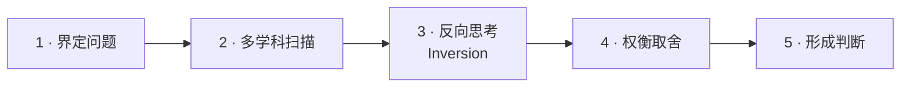
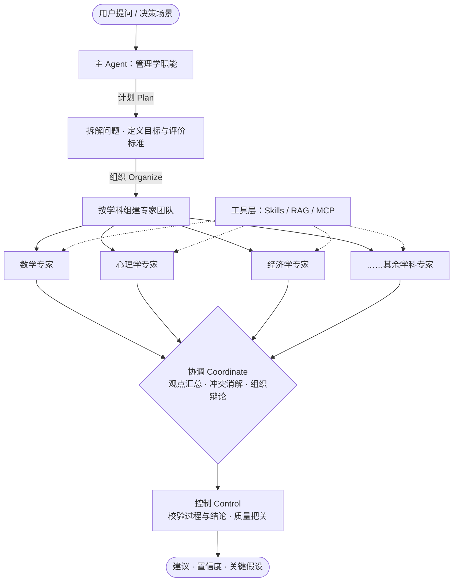

<div align="center">

[English](README.md) · [**简体中文**](README.zh-CN.md)

# MungerMind

**像芒格一样思考 —— 用多元思维模型打破 AI Agent 的创新边界**

*Think like Munger — a cross-disciplinary mental-model engine for multi-agent decision support.*

[](https://www.python.org/)
[](https://docs.astral.sh/uv/)
[](https://platform.openai.com/docs)
[](https://github.com/crewAIInc/crewAI)
[](https://modelcontextprotocol.io/)
[](#-路线图)
[](#-贡献指南)

[快速开始](#-快速开始) · [核心理念](#-核心理念) · [系统架构](#-系统架构) · [路线图](#-路线图) · [常见问题](#-常见问题)

</div>

---

## 📑 目录

- [✨ 核心特性](#-核心特性)
- [📖 项目简介](#-项目简介)
- [🧠 核心理念](#-核心理念)
  - [多元思维模型](#多元思维模型)
  - [强制思考顺序](#强制思考顺序)
  - [多智能体专家架构](#多智能体专家架构)
  - [管理学的引入](#管理学的引入)
  - [社会心理学的引入](#社会心理学的引入)
  - [工具层](#工具层)
  - [液态玻璃界面](#液态玻璃界面)
- [🧩 系统架构](#-系统架构)
- [🚀 快速开始](#-快速开始)
- [🔧 配置说明](#-配置说明)
- [📦 项目结构](#-项目结构)
- [🔒 隐私模式](#-隐私模式)
- [🧭 路线图](#-路线图)
- [❓ 常见问题](#-常见问题)
- [🤝 贡献指南](#-贡献指南)
- [📄 许可证](#-许可证)
- [🙏 致谢](#-致谢)

---

## ✨ 核心特性

| 特性 | 说明 |
| --- | --- |
| 🧠 **多元思维模型** | 内置数学、物理、化学、工程学、天文学与大气科学、心理学、生物学、医学、哲学、历史学、法学、经济学十二大学科模型库 |
| 🪜 **强制思考顺序** | 用固定的推理流水线约束 Agent，拒绝"跳步"与"抢答" |
| 👥 **多智能体专家团队** | 基于 CrewAI，一个领域一个专家；先独立视角，后统一判断 |
| 🎛️ **管理学职能** | 主 Agent 承担计划（Plan）、组织（Organize）、协调（Coordinate）、控制（Control）四类管理者职责 |
| 🎭 **社会心理学治理** | 用群体动力学原理管控 Agent 群体，识别并破除群体思维 |
| 🔌 **工具层解耦** | Skills / RAG / MCP 负责操作外界工具，与推理层分离 |
| 🔒 **隐私模式** | 可选的"七秒钟记忆的鱼"无记忆模式，对话结束即遗忘 |
| 🪟 **液态玻璃界面** | 通透、流动、层次分明的前端，让复杂推理链路一目了然 |

---

## 📖 项目简介

MungerMind 是一个以查理·芒格（Charlie Munger）**多元思维模型**（Latticework of Mental Models）为内核的多智能体（Multi-Agent）决策系统。它不满足于让单个模型"直接给出答案"，而是**强制 Agent 按照跨学科的思维框架、按既定的思考顺序推进推理**，从而在复杂、模糊、跨领域的问题上给出更稳健的判断。

项目的目标不是替代人，而是**只辅助决策**：把散落在各个学科中的经典模型组织成一套可复用的推理网络，让 Agent 在给建议之前，先走完"该走的路"。

> [!NOTE]
> 在手拿锤子的人眼里，所有问题都像钉子。—— 多元思维模型正是为了对抗单一视角的工具性偏误。

---

## 🧠 核心理念

### 多元思维模型

系统内置覆盖十二大学科领域的思维工具箱，每个领域提供该学科中最具解释力与决策价值的经典模型：

| 学科 | 典型模型（示例） |
| :--- | :--- |
| ➗ 数学 | 复利、概率与期望值、贝叶斯更新 |
| 🧲 物理 | 临界点、杠杆、熵与耗散 |
| ⚗️ 化学 | 催化、反应速率、平衡移动 |
| 🔧 工程学 | 冗余设计、安全边际、反馈回路 |
| 🌪️ 天文学与大气科学 | 混沌与天气预报的极限、尺度效应 |
| 🧠 心理学 | 认知偏误、激励扭曲、误判心理学 |
| 🧬 生物学 | 进化与适应、生态位、红皇后效应 |
| 🩺 医学 | 鉴别诊断、先排除致命项、剂量-反应 |
| 🏛️ 哲学 | 第一性原理、可证伪性、奥卡姆剃刀 |
| 📜 历史学 | 路径依赖、周期律、以史为鉴的陷阱 |
| ⚖️ 法学 | 举证责任、先例、程序正义 |
| 📈 经济学 | 机会成本、比较优势、激励相容 |

### 强制思考顺序

系统为 Agent 定义了强制的推理流水线（*Think Like Munger*），避免"跳步"与"抢答"：



| 步骤 | 关键问题 |
| :---: | :--- |
| 1 · 界定问题 | 真正要解决的问题是什么？ |
| 2 · 多学科扫描 | 哪些模型可以解释当前现象？ |
| 3 · 反向思考 | 什么会导致彻底失败？先排除它。 |
| 4 · 权衡取舍 | 机会成本、安全边际、概率加权如何？ |
| 5 · 形成判断 | 给出建议、置信度与关键假设。 |

### 多智能体专家架构

借助 [CrewAI](https://github.com/crewAIInc/crewAI) 将系统组织为**一个领域一个专家**的团队：每个学科对应一个具备专属思维模型与知识背景的专家 Agent，由它们分别提供视角，再由协调者汇总为统一判断。

### 管理学的引入

为**主 Agent** 注入管理学职能，使其像一位管理者而非单纯的问答者：

- 🗂️ **计划（Plan）** —— 拆解任务、确定目标与评价标准
- 🧑‍🤝‍🧑 **组织（Organize）** —— 挑选并组建合适的专家团队
- 🔄 **协调（Coordinate）** —— 对齐各专家观点、消解冲突、组织辩论
- 🛡️ **控制（Control）** —— 校验过程与结论、把关输出质量

### 社会心理学的引入

多智能体系统本身就是一个"小社会"。项目借鉴社会心理学原理治理 Agent 群体：

- 群体思维（Groupthink）的识别与破除
- 从众（Conformity）与权威偏误的抑制
- 角色分工与责任扩散（Diffusion of Responsibility）的控制
- 通过"异议者"角色保障批判性讨论

### 工具层

Agent 的**推理能力**与其**操作外界**的能力分离，由工具层负责"动手"：

| 组件 | 职责 |
| :--- | :--- |
| 🧰 **Skills** | 封装可复用的领域工作流与操作流程 |
| 📚 **RAG** | 检索增强生成，为推理注入可靠的外部知识 |
| 🔌 **MCP** | [Model Context Protocol](https://modelcontextprotocol.io/)，标准化的外部工具与数据源接入 |

### 液态玻璃界面

前端采用**液态玻璃**（Liquid Glass）视觉风格，以通透、流动、层次分明的界面呈现多专家的思考过程与结论，让复杂的推理链路一目了然。

---

## 🧩 系统架构



> [!IMPORTANT]
> 系统始终坚持"只辅助决策"的定位：输出的是**建议、置信度与关键假设**，而非替人拍板的结论。

---

## 🚀 快速开始

> [!WARNING]
> 本项目处于**早期孵化阶段（alpha）**。当前处于**骨架阶段**：[mungermind/__main__.py](./mungermind/__main__.py) 与 [frontend/index.html](./frontend/index.html) 为占位文件，各模块仅声明职责。下方命令用于准备开发环境；功能调用示例将在首个可用版本发布后补全。

### 环境要求

| 依赖 | 版本 | 说明 |
| :--- | :--- | :--- |
| **Python** | `>= 3.13` | 见 [.python-version](./.python-version) |
| **uv** | 最新版 | 依赖与虚拟环境管理，见 [uv 文档](https://docs.astral.sh/uv/) |
| **OpenAI API Key** | — | 模型接入凭证 |

### 安装

```bash
# 1. 克隆仓库
git clone https://github.com/Turbulence123/MungerMind.git
cd mungermind

# 2. 同步依赖（读取 pyproject.toml 与 uv.lock）
uv sync

# 3. 配置环境变量：编辑 .env 填入你的密钥，参见「配置说明」
```

### 运行

```bash
uv run python -m mungermind
```

---

## 🔧 配置说明

配置通过 [.env](./.env) 加载（依赖 `python-dotenv`）。客户端会自动识别服务商，切换后端无需改动代码：

```dotenv
# .env —— 配置一个服务商即可
LLM_API_KEY=sk-xxxxxxxxxxxxxxxx
LLM_BASE_URL=https://api.deepseek.com
LLM_MODEL_ID=deepseek-flash
```

识别顺序：显式 `provider=` → 服务地址（`base_url=` / `LLM_BASE_URL`）→ 服务商专属环境变量 → 密钥格式 → `openai`。显式配置的服务地址优先于无关的服务商密钥，因此残留的 `MODELSCOPE_API_KEY` 不会劫持 DeepSeek 配置。

| 变量 | 必填 | 默认值 | 说明 |
| :--- | :---: | :--- | :--- |
| `LLM_PROVIDER` | ⭕ | 自动 | 强制指定服务商：`openai`、`modelscope`、`zhipu`、`deepseek`、`dashscope`、`moonshot`、`siliconflow`、`openrouter`、`ollama`、`vllm`、`local`、`auto` |
| `LLM_API_KEY` | ⭕ | — | 通用密钥，服务商没有专属变量时使用 |
| `LLM_BASE_URL` | ⭕ | 服务商默认值 | OpenAI 兼容服务地址；其域名/端口同时用于自动识别 |
| `LLM_MODEL_ID` | ⭕ | 服务商默认值 | 请求时使用的模型名 |
| `LLM_TIMEOUT` | ⭕ | `60` | 请求超时（秒） |
| `MODELSCOPE_API_KEY` | ⭕ | — | ModelScope 密钥（自动识别 `ms-` 前缀） |
| `ZHIPU_API_KEY` | ⭕ | — | 智谱 AI 密钥（自动识别 `id.secret` 格式） |
| `OPENAI_API_KEY` | ⭕ | — | OpenAI 密钥 |
| `DEEPSEEK_API_KEY` | ⭕ | — | DeepSeek 密钥 |
| `DASHSCOPE_API_KEY` | ⭕ | — | 阿里云百炼密钥 |
| `MOONSHOT_API_KEY` | ⭕ | — | Moonshot 密钥 |
| `SILICONFLOW_API_KEY` | ⭕ | — | 硅基流动密钥 |
| `OPENROUTER_API_KEY` | ⭕ | — | OpenRouter 密钥 |
| `OLLAMA_HOST` | ⭕ | `http://localhost:11434/v1` | 本地 Ollama 地址；可省略协议头 |
| `VLLM_BASE_URL` | ⭕ | `http://localhost:8000/v1` | 本地 vLLM 地址 |
| `REDIS_URL` | ⭕ | — | 隐私模式的 TTL 存储；未配置时回退至内存 |

> [!NOTE]
> 本地服务无需真实密钥（框架会自动填入 `ollama` / `vllm` 占位值）；vLLM 仍需通过 `LLM_MODEL_ID` 或 `model=` 指定与服务端一致的模型名。`.env` 已被 [.gitignore](./.gitignore) 忽略，请勿提交密钥。

---

## 📦 项目结构

```text
MungerMind/
├── mungermind/                  # 主包（扁平布局）
│   ├── __main__.py              #   CLI 入口：`python -m mungermind`
│   ├── config.py                #   运行时配置
│   ├── agents/                  #   主 Agent 与各学科专家
│   │   ├── base.py              #     Agent 公共抽象
│   │   ├── coordinator.py       #     主 Agent：计划/组织/协调/控制
│   │   ├── expert_factory.py    #     按学科装配专家
│   │   └── roles/dissenter.py   #     异议者角色（反群体思维）
│   ├── mental_models/           #   多元思维模型库
│   │   ├── model.py             #     思维模型数据结构
│   │   ├── registry.py          #     按学科与触发条件建立索引
│   │   └── disciplines/         #     十二学科，每学科一个模块
│   ├── reasoning/               #   强制思考顺序
│   │   ├── pipeline.py          #     按序驱动五个步骤
│   │   └── steps/               #     界定/扫描/反向/权衡/判断
│   ├── management/              #   计划、组织、协调、控制
│   ├── governance/              #   社会心理学管控机制
│   ├── tools/                   #   Skills / RAG / MCP
│   ├── memory/                  #   记忆后端（含隐私模式）
│   │   └── privacy.py           #     「七秒钟记忆的鱼」：Redis TTL + 滚动窗口
│   ├── core/                    #   运行时基础组件
│   │   ├── llm.py               #     支持服务商自动识别的 OpenAI 兼容客户端
│   │   ├── message.py           #     统一消息格式
│   │   ├── config.py            #     集中配置
│   │   ├── exceptions.py        #     框架异常
│   │   └── agent.py             #     Agent 抽象基类
│   └── prompts/                 #   提示词资产与加载器
├── frontend/                    # 液态玻璃前端界面
├── tests/                       # 测试套件
├── docs/                        # 文档
├── examples/                    # 可运行示例
├── config/                      # 配置样例
├── scripts/                     # 开发与运维脚本
├── pyproject.toml               # 项目定义与依赖清单
├── uv.lock                      # 依赖锁定文件
├── .python-version              # Python 版本约束
├── .env                         # 环境变量（不纳入版本控制）
├── .gitignore
└── MungerMind.code-workspace    # VS Code 工作区配置
```

---

## 🔒 隐私模式

> "七秒钟记忆的鱼"：对话结束，即被遗忘。

不同于默认的长期记忆型 Agent，MungerMind 提供一种**可选**的"无记忆"模式（可命名为**隐私模式**或**一次性任务模式**）：对话在时间与轮次两个维度上都保持短暂记忆，对话结束即遗忘。

这是一个强大的**隐私保护工具**，但并非通用记忆方案：

| 维度 | 说明 |
| :--- | :--- |
| ✅ **核心优势** | 隐私、成本、隔离性 |
| ⚠️ **核心代价** | 牺牲对话的长期连贯性 |

**实现路径**

| 维度 | 方案 |
| :--- | :--- |
| 时间维度 | 利用 **Redis TTL** 自动过期 |
| 轮次维度 | 利用滚动窗口（如 LangChain 的 `trim_messages`）限制上下文长度 |

**参考对象**：ChatGPT 的临时模式、Swarms 的默认临时 Agent、`forgetted` 库的实现思路。

> [!TIP]
> **定位建议**：将该模式作为可选开关而非默认行为。用户在处理敏感信息或进行一次性查询时主动开启，在需要长期陪伴或复杂任务时切换回标准模式。

---

## 🧭 路线图

- [x] 项目骨架与依赖管理（uv）
- [ ] 多元思维模型库（十二学科）
- [ ] 强制思考顺序引擎
- [ ] CrewAI 多智能体专家团队
- [ ] 主 Agent 管理学职能（计划 / 组织 / 协调 / 控制）
- [ ] 社会心理学管控机制（异议者角色、群体思维破除）
- [ ] 工具层：Skills / RAG / MCP
- [ ] 隐私模式（Redis TTL + 滚动窗口）
- [ ] 液态玻璃前端界面

---

## ❓ 常见问题

<details>
<summary><b>为什么叫 MungerMind？</b></summary>

<br/>

取自查理·芒格及其"多元思维模型"（Latticework of Mental Models）思想。项目的核心主张是：**不靠单一模型下判断，而靠跨学科的模型网格逼近真相**。

</details>

<details>
<summary><b>它和普通 Chatbot 有什么区别？</b></summary>

<br/>

普通 Chatbot 倾向于"直接给答案"，而 MungerMind **强制走完既定的思考顺序**，并由多个学科专家 Agent 分别给出视角后再汇总，最终输出的是"建议 + 置信度 + 关键假设"。

</details>

<details>
<summary><b>隐私模式会取代标准模式吗？</b></summary>

<br/>

不会。隐私模式是**可选开关**，用于敏感信息或一次性查询场景；需要长期陪伴或复杂任务时，请使用标准模式。

</details>

<details>
<summary><b>现在可以跑起来吗？</b></summary>

<br/>

尚未。仓库目前是项目骨架，核心能力正在设计与实现中，欢迎关注 [路线图](#-路线图)。

</details>

---

## 🤝 贡献指南

欢迎任何形式的贡献：报告问题、提出想法、提交代码。

```bash
# 1. Fork 本仓库后克隆到本地
git clone https://github.com/Turbulence123/MungerMind.git

# 2. 创建特性分支
git checkout -b feat/your-feature

# 3. 提交并推送
git commit -m "feat: add something"
git push origin feat/your-feature
```

随后提交 Pull Request 即可。

> [!TIP]
> 提交信息建议遵循 [Conventional Commits](https://www.conventionalcommits.org/zh-hans/v1.0.0/) 规范（`feat` / `fix` / `docs` / `refactor` / `chore`）。
>
> 特别欢迎就**十二学科模型清单**与**主 Agent 管控策略**在 Issues 中展开讨论。

---

## 📄 许可证

许可证**待定**（TBD）。在正式确定之前，请勿将本项目用于商业用途。

---

## 🙏 致谢

- 🧠 [Charles T. Munger](https://zh.wikipedia.org/wiki/查理·芒格) —— "多元思维模型"思想的源头
- 👥 [CrewAI](https://github.com/crewAIInc/crewAI) —— 多智能体协作框架
- 🔌 [Model Context Protocol](https://modelcontextprotocol.io/) —— 外部工具接入标准
- 🐍 [uv](https://docs.astral.sh/uv/) —— 快速可靠的 Python 包管理

---

<div align="center">

**如果这个项目对你有启发，欢迎点亮 ⭐ Star 支持！**

</div>
